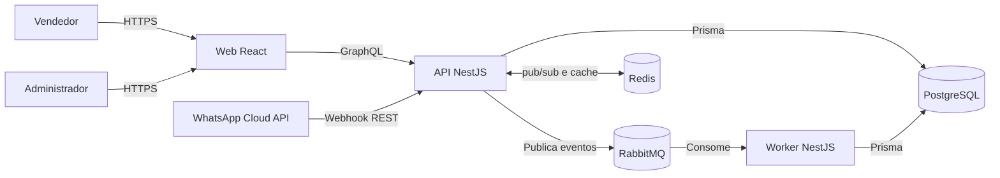
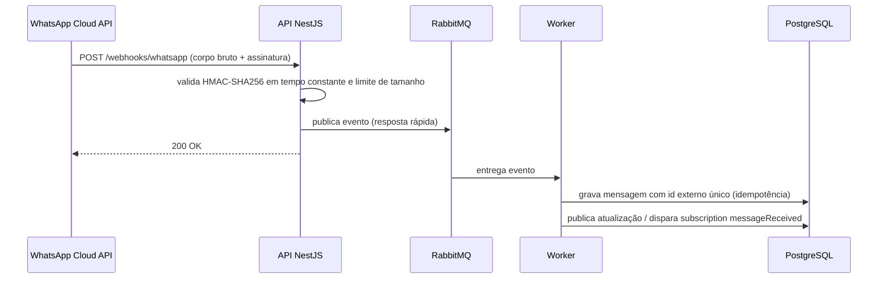

# Arquitetura

Status: Fase 0 (fundação). O domínio, o schema GraphQL e as integrações serão
adicionados nas fases seguintes.

## Contexto



## Contêineres

| Contêiner     | Responsabilidade                             | Estado na Fase 0                                      |
| ------------- | -------------------------------------------- | ----------------------------------------------------- |
| `apps/web`    | SPA React, Apollo Client na Fase 4           | Shell acessível com Vite e Tailwind                   |
| `apps/api`    | GraphQL BFF, REST de webhook, autenticação   | Esqueleto NestJS com health checks e segurança básica |
| `apps/worker` | Consumo de eventos do WhatsApp               | Esqueleto NestJS com health check                     |
| PostgreSQL    | Persistência principal                       | Serviço no Docker Compose                             |
| Redis         | Pub/sub de subscriptions, cache e rate limit | Serviço no Docker Compose                             |
| RabbitMQ      | Fila durável de webhooks                     | Serviço no Docker Compose                             |

## Fluxo do webhook (planejado para a Fase 3)



## Camadas da API

```text
Resolver (GraphQL, fino)
  → Service (casos de uso e regras)
    → Repository (Prisma)
      → Portas/adaptadores (WhatsApp, fila, cache)
```

Resolvers não acessam Prisma diretamente e não concentram regra de negócio.
Dependências apontam para o domínio; integrações externas ficam em adaptadores.

## Decisões

- Monorepo e orquestração: [ADR-001](../adr/ADR-001-monorepo-pnpm-turborepo.md).
- Stack da API, mensageria e front-end: [ADR-002](../adr/ADR-002-stack-api-graphql.md).
- Versões e compatibilidade: [ADR-003](../adr/ADR-003-versoes-e-compatibilidade.md).

## Portas locais

| Serviço             | Porta |
| ------------------- | ----- |
| Web                 | 5217  |
| API                 | 3202  |
| Worker (interna)    | 3203  |
| PostgreSQL          | 5402  |
| Redis               | 8203  |
| RabbitMQ AMQP       | 8204  |
| RabbitMQ Management | 8205  |

## Limitações atuais

- A API ainda não expõe GraphQL.
- Não há persistência, autenticação, subscriptions ou processamento de fila.
- Os health checks verificam apenas o processo, não dependências externas.
