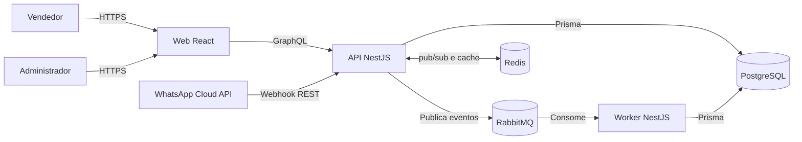
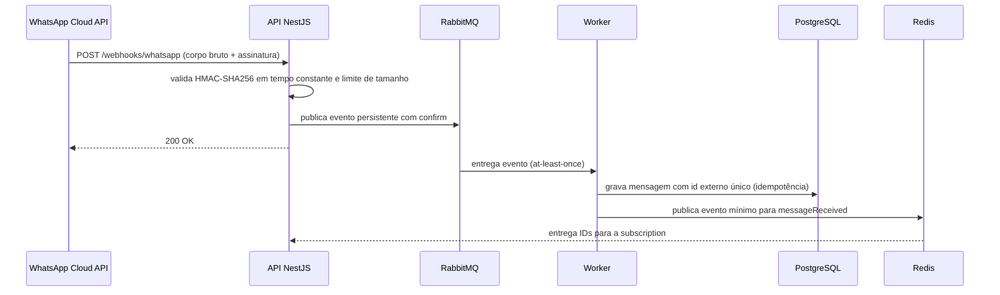

# Arquitetura

Status: Fases 0 a 4 implementadas. A Fase 3 adicionou webhook de WhatsApp,
fila durável com retry/DLQ, worker idempotente, conversas/mensagens,
subscription `messageReceived` e exportação/exclusão LGPD. A Fase 4 entregou
a SPA React com sessão, contatos, kanban, inbox em tempo real e dashboard.

## Contexto



## Contêineres

| Contêiner     | Responsabilidade                             | Estado atual                                                              |
| ------------- | -------------------------------------------- | ------------------------------------------------------------------------- |
| `apps/web`    | SPA React, Apollo Client HTTP/WS             | Sessão, contatos/360°, kanban, inbox e dashboard com tema e i18n          |
| `apps/api`    | GraphQL BFF, REST de webhook, autenticação   | Auth, contatos, empresas, negócios, atividades, dashboard e subscriptions |
| `apps/worker` | Consumo de eventos do WhatsApp               | Health check, consumer, retry/DLQ e publicação Redis                      |
| PostgreSQL    | Persistência principal                       | Migrations e seed das Fases 1, 2 e 3                                      |
| Redis         | Pub/sub de subscriptions, cache e rate limit | Pub/sub de `dealMoved`/`messageReceived` e cache do dashboard             |
| RabbitMQ      | Fila durável de webhooks                     | Exchange, fila inbound, retries 5s/30s/5m e DLQ                           |

## Fluxo do webhook



## Camadas da API

```text
Resolver (GraphQL, fino)
  → Service (casos de uso e regras)
    → Repository (Prisma)
      → Portas/adaptadores (WhatsApp, fila, cache)
```

Resolvers não acessam Prisma diretamente e não concentram regra de negócio.
Dependências apontam para o domínio; integrações externas ficam em adaptadores.

## Front-end (Fase 4)

```text
main.tsx
  → I18nProvider → ThemeProvider → ApolloProvider → AuthProvider
    → BrowserRouter → App (shell + guards) → páginas
```

- `SessionStore` guarda o access token apenas em memória; o refresh vive em
  cookie `HttpOnly`. `AuthProvider` faz bootstrap por `/auth/refresh` e expõe
  `loading | anonymous | authenticated`.
- `apolloClient` usa links HTTP e `graphql-ws`; o logout limpa o cache e a
  conexão. Erros são normalizados em `unauthorized`, `forbidden`, `notFound`,
  `validation`, `conflict`, `network` e `unknown`.
- Documentos e tipos vêm de `packages/graphql-schema` (codegen a partir de
  `apps/web/src/**/*.graphql`); o cliente consome `DocumentNode`.
- As telas usam React Router 7, react-hook-form + zod, Tailwind 4 e `@dnd-kit`
  no kanban. A busca é server-side e usa cursor; filtros ficam na URL.
- Acessibilidade: landmarks, link de salto, foco visível, `aria-live` para
  rota e mensagens, menu de teclado no kanban e movimento sem arrastar.

## Decisões

- Monorepo e orquestração: [ADR-001](../adr/ADR-001-monorepo-pnpm-turborepo.md).
- Stack da API, mensageria e front-end: [ADR-002](../adr/ADR-002-stack-api-graphql.md).
- Versões e compatibilidade: [ADR-003](../adr/ADR-003-versoes-e-compatibilidade.md).
- Autenticação REST e RBAC por propriedade: [ADR-004](../adr/ADR-004-autenticacao-rest-e-rbac.md).
- Subscriptions via `graphql-ws` e cache Redis: [ADR-005](../adr/ADR-005-subscriptions-graphql-redis.md).
- WhatsApp, RabbitMQ e idempotência: [ADR-006](../adr/ADR-006-whatsapp-rabbitmq-idempotencia.md).
- Exportação e exclusão LGPD: [ADR-007](../adr/ADR-007-lgpd-exportacao-exclusao.md).

## Portas locais

| Serviço             | Porta |
| ------------------- | ----- |
| Web                 | 5217  |
| API                 | 3202  |
| Worker (interna)    | 3203  |
| PostgreSQL          | 5402  |
| Redis               | 8203  |
| RabbitMQ AMQP       | 8204  |
| RabbitMQ Management | 8205  |

## Limitações atuais

- A SPA cobre os fluxos da Fase 4; E2E Playwright, axe e code splitting
  ficam para a Fase 5.
- Subscriptions e eventos são best-effort; não há outbox transacional nem
  exactly-once.
- O worker reconecta ao broker, mas replay de DLQ é manual.
- Mídia e webhooks de status do WhatsApp ficam fora do escopo.
- Os health checks verificam apenas o processo, não dependências externas.
- Rate limit (login/GraphQL/WS), persisted queries e limite de corpo foram
  implementados na Fase 5 (TASK-006-01, ADR-009); benchmark k6 e E2E ficam nas
  TASK-006-02/03.
- O bundle principal tem ~708 kB; code splitting por rota é pendente.
